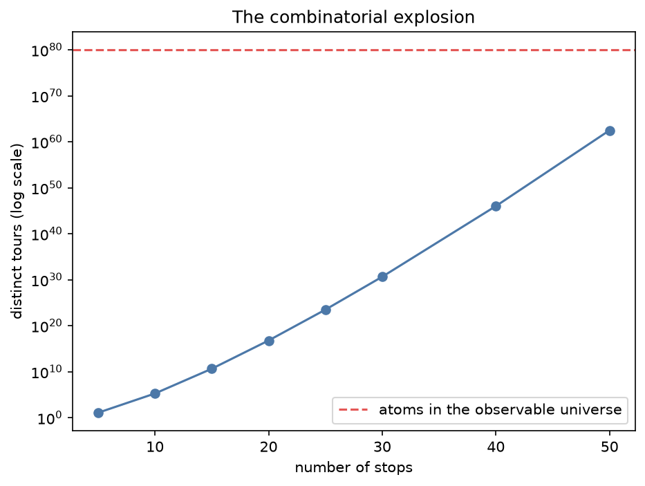
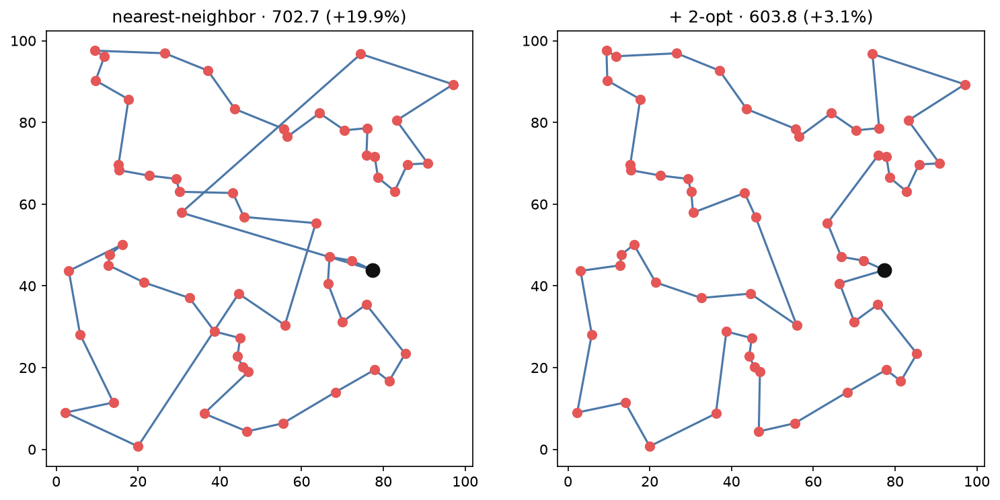
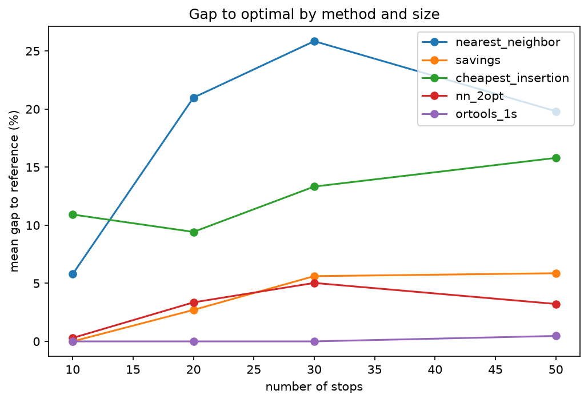

# routing_arena

**The traveling salesman problem is everywhere, and your exact solver gives up at 20 stops.**

A head-to-head comparison of the ways to route a vehicle through a set of stops — brute force, an
exact MILP, from-scratch heuristics (nearest-neighbor, Clarke-Wright savings, cheapest insertion,
2-opt, or-opt), and OR-Tools guided local search — built entirely on CPU and runnable inside a
**2-CPU / 8 GB GitHub Codespace, no GPU**.

The traveling-salesman and vehicle-routing problems decide every delivery run, service route, and
warehouse pick path. They also blow up so fast that an exact solver that is instant at ten stops is
hopeless at fifty. This project makes that visceral and shows what to do instead.

## The thesis

- **TSP/VRP are NP-hard.** The number of distinct tours through `n` stops grows *factorially* —
  fifty stops has more possible tours than the observable universe has atoms. No solver escapes it.
- **Exact is real, but only to the high teens of stops** on a 2-CPU machine. The wall is
  arithmetic, not solver quality.
- **Nearest-neighbor** is ten lines, instant, and reliably ~20–25 % above optimal — a baseline,
  never a production route.
- **2-opt** on a nearest-neighbor start reaches **within a few percent of optimal** in a fraction
  of a second. Add **or-opt** and it is essentially optimal.
- **OR-Tools** guided local search matches that *and* handles capacities, multiple vehicles, and
  time windows the exact MILP cannot touch at scale.
- The lesson: **give up on optimality on purpose.** Pick the method by instance size and
  constraints, and always know your gap-to-optimal by checking against exact on a small same-type
  instance.

## See it

The combinatorial explosion — distinct tours vs stops, against the atoms in the universe:



2-opt uncrossing a clumsy nearest-neighbor route into a near-optimal one, for almost nothing:



The scoreboard — gap to optimal by method as instances grow (nearest-neighbor drifts to ~20 %;
2-opt and OR-Tools stay near zero):



## Quickstart

Open in a GitHub Codespace (or any Python 3.11+ machine) and:

```bash
make setup      # install uv if needed, uv sync --all-extras, register the Jupyter kernel
make test       # run the test suite (the project's asserted claims)
make notebooks  # execute all six notebooks in place
make run        # launch the Streamlit app on port 8501
make help       # list every target
```

Everything runs through [`uv`](https://docs.astral.sh/uv/); there is no `pip`/`conda` step and no
GPU.

## The notebooks

The narrative arc, in order (each self-contained, each well under five minutes on 2 CPUs):

| # | Notebook | What it shows |
|---|---|---|
| 01 | [`the_explosion`](notebooks/01_the_explosion.ipynb) | Factorial tour growth vs atoms in the universe; brute force slowing from instant to hopeless. |
| 02 | [`exact_tsp`](notebooks/02_exact_tsp.ipynb) | The TSP as a MILP (subtour elimination), validated against brute force, then pushed until solve time explodes. |
| 03 | [`construction_heuristics`](notebooks/03_construction_heuristics.ipynb) | Nearest-neighbor, savings, and insertion — complete routes instantly, and exactly how far from optimal each lands. |
| 04 | [`local_search`](notebooks/04_local_search.ipynb) | 2-opt and or-opt closing the gap to a few percent, with monotone tour-length improvement. |
| 05 | [`vehicle_routing`](notebooks/05_vehicle_routing.ipynb) | The VRP with capacities, a fleet, and time windows via OR-Tools — the last-mile layer of a supply chain. |
| 06 | [`arena_and_decisions`](notebooks/06_arena_and_decisions.ipynb) | The full scoreboard, the exact→heuristic crossover, and the decision framework. |

Every figure is saved to [`outputs/figures/`](outputs/figures/) as a PNG and every number, table,
and parameter block to [`outputs/data/`](outputs/data/) as JSON, so each figure and statistic is
reproducible and traceable.

## The Streamlit app

`make run` launches four interactive pieces, all calling the same `src/` library:

1. **Explosion meter** — add stops and watch the tour count and exact solve time climb.
2. **Route builder** — drop stops and watch nearest-neighbor, 2-opt, and OR-Tools draw their
   routes with lengths and gap-to-optimal.
3. **2-opt animator** — watch local search uncross edges one swap at a time.
4. **Fleet dispatcher** — set vehicles and capacity and watch OR-Tools split the stops into routes.

## Repository layout

```
config/settings.yaml   Instance sizes, vehicle counts, capacities, time budgets, seeds
notebooks/             01 … 06, the narrative arc
src/
  problems/            TSP distance matrices & VRP instances (depot, demands, time windows)
  exact/               brute_force (ground truth) · milp_tsp (MTZ subtour elimination)
  heuristics/          nearest_neighbor · christofides_like (savings/insertion) · two_opt · or_opt
  ortools_solver/      routing — OR-Tools TSP/VRP with guided local search
  evaluation/          gap_to_optimal · scaling (time vs stops) · comparison (arena harness)
  visualisation.py     Shared plotting
  reporting.py         save_figure (PNG) / save_json — persist every notebook artifact
app/streamlit_app.py   The interactive app
tests/                 MILP == brute force · 2-opt monotonicity · OR-Tools gap · VRP feasibility
outputs/               figures/ (PNG) and data/ (JSON)
```

Algorithms live in `src/`; the notebooks and the app import and call them rather than
reimplementing anything inline.

## Methods and solvers

All solvers are **open-source, no license key**:

- **[OR-Tools](https://developers.google.com/optimization)** — the routing engine with guided
  local search, for both TSP and the full VRP.
- **[PuLP](https://coin-or.github.io/pulp/)** with the bundled **CBC** solver — the exact MILP
  (Miller-Tucker-Zemlin subtour elimination). This is the default `milp_tsp` backend.
- **HiGHS** is available as an alternative MILP backend via its command-line binary
  (`milp_tsp(backend="highs")`), run out-of-process.

Brute force, nearest-neighbor, savings, cheapest insertion, 2-opt, and or-opt are all implemented
**from scratch** in [`src/`](src/) so you can see exactly what the production tools do inside.

## Tech & constraints

Python 3.11+ · `uv` for dependencies · 2 CPU cores · 8 GB RAM · no GPU. Distance matrices stay at a
few hundred square. Every heuristic run is near-instant; exact methods are run only on small
instances by design, precisely to show where they stop. Linting with `ruff`, type-checking with
`ty`, tests with `pytest` — all via `make lint` / `make test` / `make ci`.

## Related projects

Part of [@Dima806](https://github.com/Dima806)'s hands-on, CPU-only data-science series:

- **[optimization_101](https://github.com/Dima806/optimization_101)** — a hands-on introduction to
  mathematical optimization, the discipline data scientists reach for last and should reach for
  first, built on CPU with open solvers. *routing_arena builds on it: routing as a MILP, and where
  exact optimization runs out of road.*
- **[supply_chain_arena](https://github.com/Dima806/supply_chain_arena)** — a hands-on tour of the
  optimization models that run the physical economy, built on CPU with open solvers. *routing is
  its last-mile layer; the VRP notebook is the handoff.*
- **[curse_of_dimensionality_101](https://github.com/Dima806/curse_of_dimensionality_101)** — a
  hands-on introduction to the single most under-appreciated fact in machine learning, that
  distance stops meaning anything as dimensions grow. *The combinatorial explosion here is the
  discrete cousin of that curse.*

## License

[Apache-2.0](LICENSE).
